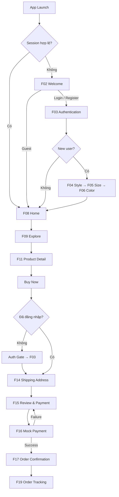

# SWAPSHE — Mobile UI/UX Screens Specification

> **Version:** 1.0  
> **Brand:** SWAPSHE — *Loved Before, Styled Again.*  
> **Phạm vi:** Mobile App, ưu tiên Flow 1 (Onboarding → Mua hàng → Theo dõi đơn)  
> **Phong cách:** Soft Vintage Chic  
> **Business Model:** C2C (một tài khoản vừa có thể mua, bán và trao đổi)  
> **Swap:** Direct Swap (1 món đổi 1 món; workflow độc lập)  
> **Payment:** Mock Payment (không chuyển tiền thật)  
> **Kích thước thiết kế tham chiếu:** 390 × 844 px; hỗ trợ safe area của thiết bị  
> **Mục đích:** Tài liệu bàn giao cho Figma Designer, Frontend và Backend.

---

## 1. Mục tiêu trải nghiệm

1. Cho phép người dùng khám phá thời trang secondhand mà **không bắt buộc đăng nhập**.
2. Cá nhân hóa thông qua **phong cách**, **size** và **màu yêu thích**; các bước có thể bỏ qua.
3. Tìm và xem thông tin thực tế của từng món quần áo: ảnh, tình trạng, thông số, giá, người bán.
4. Hoàn tất luồng mua hàng với **thanh toán mô phỏng** và xử lý trường hợp sản phẩm hết hàng.
5. Theo dõi đơn và xác nhận nhận hàng.
6. Chuẩn bị sẵn lối vào Sell/Swap, nhưng **không làm phức tạp Flow 1**.

### Nguyên tắc sản phẩm

- Một tài khoản dùng cho Buyer, Seller và Swapper; không tạo loại tài khoản riêng.
- Mỗi listing đồ secondhand trong MVP có **số lượng mặc định là 1**.
- Size gợi ý không có nghĩa bảo đảm vừa; luôn ưu tiên số đo thật của sản phẩm.
- Không yêu cầu dữ liệu cơ thể nhạy cảm nếu không thực sự cần; số đo là tùy chọn và riêng tư.
- Không hiển thị mock payment như giao dịch thật. Mã đơn nội bộ khác mã vận đơn.
- Guest được xem Home, Explore, Product Detail; đăng nhập khi checkout hoặc sử dụng tính năng cần đồng bộ tài khoản.

---

## 2. Danh sách màn hình (Screen Inventory)

**Ký hiệu:** `P0` = thiết kế trước cho interactive demo (13 screen IDs); `P1` = mở rộng/thiết kế sau. Screen F03 bao gồm cả Login và Register trong một hệ màn hình có variants.

| ID | Screen | Nhóm | Ưu tiên | Route gợi ý |
|---|---|---|---|---|
| F01 | Splash | Entry | P1 | `/splash` |
| F02 | Welcome | Entry | **P0** | `/welcome` |
| F03 | Login / Register / Forgot Password | Authentication | **P0** | `/auth` |
| F04 | Style Preference | Onboarding | **P0** | `/onboarding/style` |
| F05 | Size Profile | Onboarding | **P0** | `/onboarding/size` |
| F06 | Color Preference | Onboarding | **P0** | `/onboarding/color` |
| F07 | Setup Completed | Onboarding | P1 | `/onboarding/complete` |
| F08 | Home | Marketplace | **P0** | `/home` |
| F09 | Explore & Search | Marketplace | **P0** | `/explore` |
| F10 | Filter & Sort | Marketplace | P1 (bottom sheet) | `/explore` + sheet |
| F11 | Product Detail | Marketplace | **P0** | `/product/:id` |
| F12 | Seller Profile | Marketplace | P1 | `/seller/:id` |
| F13 | Wishlist | Marketplace | P1 | `/wishlist` |
| F14 | Shipping Address | Checkout | **P0** | `/checkout/address` |
| F15 | Review & Payment | Checkout | **P0** | `/checkout/review` |
| F16 | Mock Payment | Checkout | **P0** | `/checkout/mock-payment` |
| F17 | Order Confirmation | Checkout | **P0** | `/checkout/success` |
| F18 | My Orders | Orders | P1 | `/orders` |
| F19 | Order Detail / Tracking | Orders | **P0** | `/orders/:id` |
| F20 | Review Order | After-sales | P1 | `/orders/:id/review` |
| F21 | My Profile | Account | P1 | `/profile` |

**13 screen IDs P0:** F02, F03, F04, F05, F06, F08, F09, F11, F14, F15, F16, F17, F19. Có thể gộp F15 + F16 thành một cụm **Payment Flow** khi trình bày 12 frame mẫu đầu tiên, nhưng nên tách hai screen khi hoàn thiện luồng nghiệp vụ. Các màn hình còn lại là phần mở rộng.

---

## 3. Sitemap / Điều hướng

```text
SWAPSHE MOBILE
├── Entry & Authentication
│   ├── F01 Splash
│   ├── F02 Welcome
│   └── F03 Login / Register / Forgot Password
│
├── Personalized Onboarding (optional)
│   ├── F04 Style Preference
│   ├── F05 Size Profile
│   ├── F06 Color Preference
│   └── F07 Setup Completed
│
├── Main Navigation
│   ├── Home
│   │   └── F08 Home
│   ├── Explore
│   │   ├── F09 Search & Product Listing
│   │   └── F10 Filter & Sort (Bottom Sheet)
│   ├── Sell (Flow 2 — later)
│   ├── Swap (Flow 3 — later)
│   └── Profile
│       ├── F21 My Profile
│       ├── F13 Wishlist
│       └── F18 My Orders
│
├── Product
│   ├── F11 Product Detail
│   └── F12 Seller Profile
│
└── Purchase / Order
    ├── Auth Gate (modal nếu guest)
    ├── F14 Shipping Address
    ├── F15 Review & Payment
    ├── F16 Mock Payment
    ├── F17 Order Confirmation
    ├── F19 Order Detail & Tracking
    └── F20 Review Order
```

### Main Bottom Navigation

| Tab | Icon gợi ý | Hành động |
|---|---|---|
| Home | House | F08 |
| Explore | Search | F09 |
| Sell | Circle Plus | Flow 2 / placeholder có thông báo |
| Swap | Repeat | Flow 3 / placeholder có thông báo |
| Profile | User | F21; guest sẽ gặp Auth Gate nếu cần |

Chỉ hiển thị Bottom Navigation trong các khu vực chính; ẩn ở Splash, Welcome, Onboarding, Checkout và Payment.

### Flow 1 chính



**UX quan trọng:** Sau Auth Gate, giữ `productId`, hành động `Buy Now` và vị trí điều hướng để tiếp tục từ Checkout, không quay về Home.

---

## 4. Design System dùng chung

### 4.1. Color Tokens

| Token | Hex | Vai trò |
|---|---|---|
| `primary` | `#754B61` | CTA chính, active state, heading điểm nhấn |
| `primarySoft` | `#D9A8B8` | Selected surface, trang trí |
| `background` | `#FFF8F2` | Welcome / Onboarding |
| `surface` | `#FFFFFF` | Cards, sheets, inputs |
| `textPrimary` | `#44343C` | Nội dung chính |
| `border` | `#EEE0DE` | Border, divider |
| `success` | `#799078` | Thành công |
| `error` | `#B76A5E` | Lỗi |

### 4.2. Typography & Layout

- Branding/Editorial Headings: **Playfair Display Semibold**.
- App UI Text: **Inter** Regular / Medium / Semibold.
- H1: 28–32px; H2: 22–24px; H3: 18–20px; Body: 14–16px; Caption: 12–13px.
- Spacing tokens: **4, 8, 12, 16, 24, 32px**.
- Mobile screen width: 390px; ngang 16px padding; tạo layout responsive.
- Primary CTA: cao 50–52px, radius 12px; Input cao 52px.
- Card radius: 16px; Bottom Sheet top radius: 24px.
- Product images: 3:4; không bóp méo ảnh thật của Seller.
- Thiết kế có safe area và hỗ trợ cỡ chữ lớn.
- Text chính Deep Cocoa trên nền sáng; không dùng Dusty Rose cho chữ nhỏ thiếu tương phản.

### 4.3. Component Library

| Component | Variants cần có |
|---|---|
| `Button/Primary` | Default, Pressed, Loading, Disabled |
| `Button/Secondary` | Default, Pressed, Disabled |
| `Input/Text` | Empty, Focused, Filled, Error, Disabled |
| `Chip/Size` | Default, Selected, Disabled |
| `Card/Style` | Default, Selected |
| `Swatch/Color` | Default, Selected |
| `Card/Product` | Available, Reserved, Sold, Loading |
| `Badge/Condition` | Like New, Excellent, Good, Fair |
| `Navigation/Bottom` | Active tab variants |
| `Sheet/Filter` | Open, Modified, Empty Results |
| `Feedback/Toast` | Success, Error, Info |
| `Order/Timeline` | Pending, Preparing, Shipped, Delivered, Completed |

### 4.4. Screen states mặc định

Các màn hình có nội dung mạng cần có `Loading`, `Content`, `Empty`, `Error`, `Offline` khi phù hợp. Các form cần có `Default`, `Focus`, `Invalid`, `Submitting`, `Success`. Mỗi trạng thái lỗi cần giải thích và có lối khôi phục hợp lý.

---

## 5. Đặc tả chi tiết từng màn hình

### F01 — Splash Screen

- **Priority:** P1 | **Route:** `/splash`
- **Goal:** Nhận diện thương hiệu, khôi phục session.
- **UI:** logo SWAPSHE, slogan, nền Warm Cream, loading indicator khi cần.
- **Interaction:** logo fade-in nhẹ; tự điều hướng khi kiểm tra session hoàn tất, không ép chờ thời gian cố định.
- **States:** Loading, Session Valid, Guest, Error.
- **Navigation:** đã đăng nhập → F08; guest → F02.
- **Figma frame:** `F01_Splash/Default`, `F01_Splash/Loading`.

### F02 — Welcome Screen

- **Priority:** P0 | **Route:** `/welcome`
- **Goal:** Giới thiệu SWAPSHE và cho phép vào ứng dụng linh hoạt.
- **UI:** logo + tagline, hero image thời trang vintage, tiêu đề **Loved Before, Styled Again.**, CTA **Create an Account**, CTA phụ **Log In**, text link **Explore as Guest**.
- **Interaction:** Register/Login → F03; Explore as Guest → F08.
- **States:** Default, Pressed, Navigation Loading.
- **Figma frame:** `F02_Welcome/Default`.
- **Notes:** Guest link phải dễ thấy, không đặt ẩn ở menu.

### F03 — Login / Register / Forgot Password

- **Priority:** P0 | **Route:** `/auth`
- **Goal:** Tạo một tài khoản chung cho Buyer, Seller, Swapper.
- **UI:** tab/segmented Login–Register, email, password, show/hide password, confirm password (Register), Forgot Password, submit CTA, validation message.
- **Interaction:** switch mode không làm mất email; validate email; báo lỗi cạnh trường; đăng ký xong có thể vào onboarding; đăng nhập trong checkout tiếp tục từ F14.
- **States:** Empty, Typing, Invalid Email, Incorrect Credentials, Submitting, Success, Server Error.
- **Navigation:** New user → F04 (hoặc Skip → F08); returning user → F08 hoặc nơi đang thao tác.
- **Figma frames:** `F03_Auth/Login`, `F03_Auth/Register`, `F03_Auth/ForgotPassword`, `F03_Auth/Error`.
- **Notes:** Không tạo Buyer Registration và Seller Registration tách biệt.

### F04 — Style Preference

- **Priority:** P0 | **Route:** `/onboarding/style`
- **Goal:** Tìm hiểu gu thời trang người dùng.
- **UI:** heading **What's your style?**, progress `1/3`, image selection cards (Vintage, Casual, Minimal, Y2K, Elegant, Streetwear), Skip, sticky Continue.
- **Interaction:** multi-select phong cách; card selected có viền Primary + check; Continue khi đã chọn ít nhất một; Skip luôn dùng được.
- **States:** Default, Selected, Multiple Selected, Skipped.
- **Navigation:** Continue/Skip → F05; Back → F03 hoặc F08 tùy điểm vào.
- **Figma frames:** `F04_Style/Default`, `F04_Style/Selected`.

### F05 — Size Profile

- **Priority:** P0 | **Route:** `/onboarding/size`
- **Goal:** Thu thập dữ liệu tùy chọn phục vụ lọc size.
- **UI:** progress `2/3`, size chips XS–XXL + Not sure; expandable **Add body measurements**; Height/Bust/Waist/Hips (cm); thông báo dữ liệu riêng tư; Back/Skip/Continue.
- **Interaction:** chọn size một lần; mở đo cơ thể theo ý muốn; ô nhập numeric + unit; validate; không ép người dùng nhập cân nặng/số đo.
- **States:** Empty, Size Selected, Measurements Expanded, Validation Error, Skipped.
- **Navigation:** F04 ← Back; F06 → Continue/Skip.
- **Figma frames:** `F05_Size/Collapsed`, `F05_Size/Expanded`, `F05_Size/Error`.
- **Notes:** Có quyền sửa/xóa dữ liệu từ Profile; không công khai số đo cá nhân.

### F06 — Color Preference

- **Priority:** P0 | **Route:** `/onboarding/color`
- **Goal:** Lưu màu trang phục yêu thích.
- **UI:** progress `3/3`, swatches có nhãn (Cream, Black, Dusty Pink, Lavender, Sage, Blue, Beige...), lựa chọn **All Colors**, Skip/Finish.
- **Interaction:** multi-select; selected có check/outline rõ; chọn All Colors thì bỏ các màu cụ thể.
- **States:** No Selection, Color Selected, All Colors, Skipped.
- **Navigation:** Back → F05; Finish/Skip → F07/F08.
- **Figma frames:** `F06_Color/Default`, `F06_Color/Selected`.
- **Notes:** Skin undertone là tính năng tùy chọn cho giai đoạn sau.

### F07 — Setup Completed

- **Priority:** P1 | **Route:** `/onboarding/complete`
- **Goal:** Xác nhận thiết lập sở thích.
- **UI:** success illustration, tóm tắt style/size/colors, CTA **Explore My Picks**.
- **Interaction:** CTA → F08; nếu save lỗi thì có Try Again.
- **States:** Saved, Save Failed, Skipped.
- **Figma frames:** `F07_OnboardingComplete/Success`, `F07_OnboardingComplete/Error`.

### F08 — Home

- **Priority:** P0 | **Route:** `/home`
- **Goal:** Hiển thị sản phẩm đáng quan tâm, dẫn tới khám phá và mua hàng.
- **UI:** header SWAPSHE + notification, search bar, editorial promotional banner, category chips, **Picked For You**, **Just Added**, product grid 2 cột, Bottom Navigation.
- **Interaction:** search → F09; category → F09 pre-filter; card → F11; heart → Wishlist (yêu cầu login nếu cần); pull-to-refresh.
- **States:** Personalized Feed, Generic Guest Feed, Loading Skeleton, Empty Recommendations, Error.
- **Navigation:** F09, F11, F13, F21.
- **Figma frames:** `F08_Home/Personalized`, `F08_Home/Guest`, `F08_Home/Loading`.
- **Notes:** Guest hoặc Skip Onboarding vẫn có feed với New Arrivals/Trending; không hiển thị trống.

### F09 — Explore & Search

- **Priority:** P0 | **Route:** `/explore`
- **Goal:** Tìm đồ theo tên, category và bộ lọc.
- **UI:** search input, category chips, Filter button, Sort button, result count, product grid, clear search.
- **Interaction:** debounce ~300ms; Enter tìm kiếm; lựa chọn filter/sort giữ khi Back; product → F11.
- **States:** Initial, Typing, Loading, Results, No Results, Network Error.
- **Navigation:** F10 sheet, F11.
- **Figma frames:** `F09_Explore/Results`, `F09_Explore/NoResults`, `F09_Explore/Loading`.

### F10 — Filter & Sort (Bottom Sheet)

- **Priority:** P1 | **Presentation:** Bottom Sheet từ F09.
- **Goal:** Lọc chính xác sản phẩm.
- **UI:** category multi-select; size chips; min/max price & slider; condition checkboxes; color swatches; style chips; sort radio; **Clear All**; sticky **Show Results**.
- **Interaction:** thay đổi trong bản nháp; Apply mới cập nhật danh sách; đóng sheet không áp dụng các thay đổi chưa xác nhận; Clear All reset.
- **States:** Default, Modified, Applied, Invalid Price Range, No Matches.
- **Navigation:** Apply → F09 cùng state lọc mới.
- **Figma frames:** `F10_Filter/Default`, `F10_Filter/Selected`, `F10_Filter/Error`.

### F11 — Product Detail

- **Priority:** P0 | **Route:** `/product/:id`
- **Goal:** Giúp người mua kiểm tra thông tin thật trước khi đặt hàng.
- **UI:** carousel ảnh (bao gồm ảnh lỗi), zoom, tên sản phẩm, giá bán, giá gốc nếu có, tình trạng, category/tags, size nhãn, số đo sản phẩm, description, seller card, shipping info, wishlist icon, sticky **Buy Now**; **Offer a Swap** nếu có thể đổi.
- **Interaction:** swipe ảnh, xem zoom, mở seller F12, favorite, Buy Now → auth gate/check availability → F14; Offer a Swap → Flow 3.
- **States:** Available, Reserved, Sold, Hidden, Loading, Error.
- **Navigation:** F12, F14, Swap Flow.
- **Figma frames:** `F11_Product/Available`, `F11_Product/Reserved`, `F11_Product/Sold`.
- **Notes:** nếu không cho Swap, Buy Now rộng toàn hàng. Nếu sản phẩm Sold/Reserved, disable Buy Now và hiển thị status rõ ràng.

### F12 — Seller Profile

- **Priority:** P1 | **Route:** `/seller/:id`
- **Goal:** Tạo niềm tin và xem các mặt hàng khác.
- **UI:** avatar, shop name, rating nếu có, member since, số giao dịch thành công, listings, report seller.
- **Interaction:** mở sản phẩm, report.
- **States:** Loading, Populated, No Listings, Error.
- **Navigation:** F11 cho từng sản phẩm.
- **Figma frame:** `F12_SellerProfile/Default`.
- **Notes:** Verified badge chỉ hiển thị nếu tồn tại quy trình xác minh thật.

### F13 — Wishlist

- **Priority:** P1 | **Route:** `/wishlist`
- **Goal:** Quản lý sản phẩm quan tâm.
- **UI:** product grid đã lưu, heart toggle, empty illustration + Explore CTA.
- **Interaction:** remove favorite, mở F11.
- **States:** Empty, Populated, Item Sold, Loading, Error.
- **Navigation:** F09, F11.
- **Figma frames:** `F13_Wishlist/Populated`, `F13_Wishlist/Empty`.

### F14 — Shipping Address

- **Priority:** P0 | **Route:** `/checkout/address`
- **Goal:** Nhập/chọn nơi nhận hàng.
- **UI:** checkout step indicator, selected product summary, Full Name, Phone, Province/City, Ward, Detailed Address, saved address, delivery option, sticky **Continue to Payment**.
- **Interaction:** prefill nếu đã có; validate theo trường; lưu lựa chọn khi Back; lựa chọn phương thức giao hàng hợp lệ.
- **States:** Empty, Prefilled, Invalid, Saving, Saved, Product Unavailable.
- **Navigation:** Back → F11; Continue → F15.
- **Figma frames:** `F14_Address/Empty`, `F14_Address/Prefilled`, `F14_Address/Error`.
- **Notes:** chỉ lấy dữ liệu cần cho giao hàng; minh họa phí vận chuyển có thể là phí demo.

### F15 — Review & Payment

- **Priority:** P0 | **Route:** `/checkout/review`
- **Goal:** Xác nhận cuối cùng trước khi thanh toán.
- **UI:** product/price summary, shipping address + Edit, shipping fee, total, mock payment method, sticky **Confirm & Pay**.
- **Interaction:** sửa địa chỉ → F14; server kiểm tra lại giá/tồn kho; submit disabled khi loading; chỉ gửi giao dịch một lần.
- **States:** Ready, Submitting, Price Updated, Product Unavailable, Error.
- **Navigation:** Confirm → F16; Edit → F14.
- **Figma frames:** `F15_Review/Ready`, `F15_Review/PriceChanged`, `F15_Review/Unavailable`.
- **Notes:** tổng tiền tính tại backend; không tin số tiền từ frontend.

### F16 — Mock Payment

- **Priority:** P0 | **Route:** `/checkout/mock-payment`
- **Goal:** Mô phỏng trả tiền, không có giao dịch thật.
- **UI:** nhãn **Simulation — No real payment**, mã order/attempt, tổng tiền, status, **Simulate Success**, **Simulate Failure**, **Retry** khi cần.
- **Interaction:** Success → đánh dấu thanh toán demo thành công và sang F17; Failure → báo lỗi, cho retry hoặc quay về review.
- **States:** Pending, Processing, Success, Failed, Expired.
- **Navigation:** Success → F17; Failure → F15 hoặc retry.
- **Figma frames:** `F16_MockPayment/Pending`, `F16_MockPayment/Processing`, `F16_MockPayment/Failure`.
- **Notes:** Mock Payment không đồng nghĩa Seller nhận tiền thật.

### F17 — Order Confirmation

- **Priority:** P0 | **Route:** `/checkout/success`
- **Goal:** Xác nhận đơn mua đã được hệ thống ghi nhận.
- **UI:** success illustration, **Order Confirmed**, internal order code, item + total, CTA **View Order**, secondary **Continue Shopping**.
- **Interaction:** View Order → F19; Continue → F08.
- **States:** Confirmed, Pending Verification, Fetch Error.
- **Navigation:** F19, F08.
- **Figma frames:** `F17_OrderSuccess/Confirmed`, `F17_OrderSuccess/Loading`.
- **Notes:** reload không tạo đơn mới; order code nội bộ khác tracking code của đối tác vận chuyển.

### F18 — My Orders

- **Priority:** P1 | **Route:** `/orders`
- **Goal:** Xem lịch sử mua hàng.
- **UI:** tabs All / Active / Completed / Cancelled; order cards, order status, last updated.
- **Interaction:** lọc, mở order detail.
- **States:** Empty, Loading, Active, Completed, Error.
- **Navigation:** F19.
- **Figma frames:** `F18_Orders/Populated`, `F18_Orders/Empty`.

### F19 — Order Detail / Tracking

- **Priority:** P0 | **Route:** `/orders/:id`
- **Goal:** Hiển thị tiến trình đơn và các hành động sau mua.
- **UI:** order code, status badge, timeline (Payment Confirmed → Seller Preparing → Shipped → Delivered → Completed), product details, shipping info, delivery detail nếu có, payment summary, CTA theo trạng thái, Report Issue.
- **Interaction:** refresh, theo dõi, Confirm Received khi Delivered, Report Issue, Cancel nếu chính sách cho phép.
- **States:** Paid, Preparing, Shipped, Delivered, Completed, Cancelled, Disputed, Error.
- **Navigation:** F20 sau khi hoàn tất; F18 khi back.
- **Figma frames:** `F19_Order/Preparing`, `F19_Order/Shipped`, `F19_Order/Delivered`, `F19_Order/Completed`, `F19_Order/Disputed`.
- **Notes:** trong MVP timeline có thể dựa trên dữ liệu demo do Seller/Admin đổi trạng thái; không giả mạo tracking thật.

### F20 — Review Order

- **Priority:** P1 | **Route:** `/orders/:id/review`
- **Goal:** Thu thập đánh giá sau giao dịch.
- **UI:** seller/item summary, 1–5 stars, optional comment, Submit.
- **Interaction:** validate rating; gửi một lần; hiển thị thành công.
- **States:** Draft, Invalid, Submitting, Submitted, Error.
- **Navigation:** quay về F19 hoặc F18.
- **Figma frame:** `F20_Review/Default`, `F20_Review/Success`.

### F21 — My Profile

- **Priority:** P1 | **Route:** `/profile`
- **Goal:** Quản lý hồ sơ và truy cập các tính năng cá nhân.
- **UI:** avatar/name, profile info, My Style & Size, My Orders, Wishlist, My Closet, Swap Requests, Shipping Addresses, Settings, Log Out.
- **Interaction:** edit profile, edit/delete measurements, vào màn hình tương ứng, logout.
- **States:** Guest, Logged In, Loading, Error.
- **Navigation:** F03 nếu guest, F13, F18, Flow 2/3.
- **Figma frames:** `F21_Profile/Guest`, `F21_Profile/LoggedIn`.

---

## 6. Wireframes low-fidelity (textual)

> Các wireframe biểu diễn cấu trúc, không phải UI high-fidelity. Khi chuyển sang Figma, dùng nội dung và các tokens tại Section 4.

### 6.1. F02 — Welcome

```text
┌──────────────────────────────────┐
│                  Explore as Guest│
│                                  │
│             SWAPSHE              │
│        PRE-LOVED FASHION         │
│                                  │
│        ┌────────────────┐        │
│        │  Hero Fashion  │        │
│        │     Image      │        │
│        └────────────────┘        │
│                                  │
│     Loved Before, Styled Again.  │
│       Subheading / Slogan       │
│                                  │
│    [   Create an Account   ]     │
│    [        Log In        ]      │
└──────────────────────────────────┘
```

### 6.2. F04 — Style Preference

```text
┌──────────────────────────────────┐
│ ←                          Skip  │
│ Step 1/3   █████░░░░░░░░░░       │
│                                  │
│ What's your style?               │
│ Choose what you love             │
│                                  │
│ ┌────────────┐ ┌─────────────┐   │
│ │ Vintage  ✓ │ │ Casual      │   │
│ │ Outfit     │ │ Outfit      │   │
│ └────────────┘ └─────────────┘   │
│ ┌────────────┐ ┌─────────────┐   │
│ │ Minimal    │ │ Y2K         │   │
│ └────────────┘ └─────────────┘   │
│                                  │
│        [ Continue → ]            │
└──────────────────────────────────┘
```

### 6.3. F05 — Size Profile

```text
┌──────────────────────────────────┐
│ ←                   Step 2/3     │
│ Find your perfect fit            │
│ Your usual clothing size         │
│ [XS] [S✓] [M] [L] [XL] [XXL]    │
│                                  │
│ + Add body measurements          │
│   (Optional)                     │
│ Height (cm)    [___________]     │
│ Bust   (cm)    [___________]     │
│ Waist  (cm)    [___________]     │
│ Hips   (cm)    [___________]     │
│                                  │
│ Your measurements stay private.  │
│ [ Skip ]                         │
│        [ Continue → ]            │
└──────────────────────────────────┘
```

### 6.4. F08 — Home

```text
┌──────────────────────────────────┐
│ SWAPSHE                     🔔  │
│ [ Search your next favorite... ] │
│                                  │
│ ┌──────────────────────────────┐ │
│ │ Vintage Editorial Banner     │ │
│ │ Discover pre-loved treasures │ │
│ └──────────────────────────────┘ │
│                                  │
│ Browse Categories        See All │
│ [Tops] [Skirts] [Pants] [Dresses]│
│                                  │
│ Picked For You           View All│
│ ┌─────────────┐ ┌─────────────┐  │
│ │ Product A   │ │ Product B   │  │
│ │ 120.000đ    │ │ 95.000đ     │  │
│ │ Size S      │ │ Size M      │  │
│ └─────────────┘ └─────────────┘  │
│                                  │
│ Home   Explore   Sell Swap User  │
└──────────────────────────────────┘
```

### 6.5. F11 — Product Detail

```text
┌──────────────────────────────────┐
│ ←       Product Details       ♡  │
│ ┌──────────────────────────────┐ │
│ │       Product Photos         │ │
│ └──────────────────────────────┘ │
│              • ○ ○             │
│                                  │
│ Soft Pink Cardigan    [Like New] │
│ 120.000đ    ~~280.000đ~~         │
│ [Size S] [Vintage] [Pink]        │
│                                  │
│ Size & Fit                       │
│ Bust 84 cm  |  Length 48 cm      │
│                                  │
│ Product Description              │
│ ...                              │
│                                  │
│ Seller: Linh's Closet       >   │
│                                  │
│ [ Offer a Swap ] [ Buy Now ]     │
└──────────────────────────────────┘
```

### 6.6. F14–F16 — Checkout

```text
┌──────────────────────────────────┐
│ ←            Checkout           │
│ 1. Shipping  →  2. Payment       │
│                                  │
│ [Photo] Pink Cardigan  120.000đ  │
│                                  │
│ Shipping Address                 │
│ Full name       [___________]    │
│ Phone           [___________]    │
│ Province/City   [___________]    │
│ Ward            [___________]    │
│ Detail Address  [___________]    │
│                                  │
│ Delivery     Standard 25.000đ    │
│ -------------------------------- │
│ Subtotal              120.000đ   │
│ Shipping               25.000đ   │
│ Total                 145.000đ   │
│                                  │
│    [ Continue to Payment ]       │
└──────────────────────────────────┘
```

### 6.7. F19 — Order Tracking

```text
┌──────────────────────────────────┐
│ ←          Order Details         │
│                                  │
│ Order #SW-20261014-001           │
│ Status: Preparing                │
│                                  │
│ ● Payment confirmed              │
│ │                                │
│ ● Seller preparing item          │
│ │                                │
│ ○ Shipped                        │
│ │                                │
│ ○ Delivered                      │
│ │                                │
│ ○ Completed                      │
│                                  │
│ Item: Soft Pink Cardigan         │
│ Seller: Linh's Closet            │
│ Total: 145.000đ                  │
│                                  │
│ [ Report a Problem ]             │
└──────────────────────────────────┘
```

---

## 7. Gợi ý cấu trúc file Figma

```text
SWAPSHE — MOBILE UIUX
├── 00 — Cover / Overview
├── 01 — Foundations
│   ├── Colors
│   ├── Typography
│   ├── Spacing & Grid
│   └── Icons
├── 02 — Components
│   ├── Buttons
│   ├── Inputs
│   ├── Chips & Swatches
│   ├── Product Cards
│   ├── Navigation
│   └── Feedback / Status
├── 03 — Entry & Onboarding
│   └── F01–F07
├── 04 — Shopping
│   └── F08–F13
├── 05 — Checkout
│   └── F14–F17
├── 06 — Orders & Profile
│   └── F18–F21
├── 07 — Screen States
│   ├── Loading / Empty / Error
│   ├── Reserved / Sold
│   ├── Payment Fail
│   └── Dispute
└── 08 — Interactive Prototype
    ├── Guest explores → Login → Buy
    ├── Registered buyer → Checkout Success
    ├── Mock Payment Failed / Retry
    └── Product Sold During Checkout
```

### Naming conventions

- Frame: `F08_Home/Personalized`, `F11_Product/Sold`, `F14_Address/Error`.
- Component: `Button/Primary/Default`, `Input/Text/Error`, `Card/Product/Available`.
- Layout: dùng Auto Layout, variables/tokens, constraints, component variants.
- Prototype: bấm CTA phải điều hướng đúng; không có button tương tác giả.

---

## 8. Business Rules và trạng thái cần phản ánh trên UI

| ID | Quy tắc | Ảnh hưởng UI |
|---|---|---|
| BR-01 | Tài khoản dùng chung cho 3 vai trò | Không chọn vai trò khi đăng ký |
| BR-02 | Mỗi listing có mặc định 1 món | Không có quantity selector trong MVP |
| BR-03 | Chỉ 1 checkout được giữ chỗ hợp lệ mỗi lúc | Hiện Reserved hoặc Sold; chặn Buy Now |
| BR-04 | Guest xem được sản phẩm | Auth Gate chỉ khi cần |
| BR-05 | Không cho mua sản phẩm do chính mình đăng | Disable Buy Now khi là owner |
| BR-06 | Mock Payment không chuyển tiền thật | Nhãn Simulation rõ ràng |
| BR-07 | Tổng tiền và tồn kho do backend xác nhận | Review giá lại trước thanh toán |
| BR-08 | Thanh toán thất bại có Retry | Không tự báo thành công |
| BR-09 | Nhận hàng hoàn tất mới được đánh giá | Review chỉ mở với order hợp lệ |
| BR-10 | Swap chỉ khả dụng khi người bán cho phép | Ẩn Offer a Swap nếu không hỗ trợ |

### Order State Machine đề xuất

```text
AVAILABLE
  → RESERVED (đề xuất 10 phút)
  → MOCK_PAYMENT_PENDING
  → PAID
  → SELLER_PREPARING
  → SHIPPED
  → DELIVERED
  → COMPLETED

Nhánh khác:
- Reservation expired → RELEASED → AVAILABLE
- Payment failed → RETRY / CANCEL
- Order cancelled → CANCELLED
- Reported issue → DISPUTED
```

**Lưu ý:** Các trạng thái phải được kiểm soát ở backend. Frontend chỉ phản ánh kết quả hợp lệ từ server. Hệ thống demo có thể cho Seller/Admin đổi trạng thái vận chuyển nhưng không mô tả đó là tracking thật.

---

## 9. Checklist nghiệm thu Flow 1

- [ ] Guest mở được Home và xem Product Detail.
- [ ] Login/Register có validate và thông báo lỗi.
- [ ] Onboarding Style/Size/Color có Skip.
- [ ] Preference được lưu và có thể cập nhật.
- [ ] Home có loading, empty/error state.
- [ ] Search và Filter/Sort hoạt động.
- [ ] Product Detail hiển thị ảnh thật, giá, size, condition, seller.
- [ ] Product Sold/Reserved không thể mua.
- [ ] Buy Now ở chế độ Guest mở login rồi trở về đúng checkout.
- [ ] Checkout xác thực địa chỉ và tổng tiền.
- [ ] Mock Payment có success và failure.
- [ ] Tạo order thành công tối đa một lần cho cùng payment attempt.
- [ ] Order Confirmation hiển thị mã đơn hàng nội bộ.
- [ ] Order Tracking hiển thị status tương ứng.
- [ ] Buyer có thể xác nhận nhận hàng khi Delivered.
- [ ] Có đường dẫn Report Issue cho giao dịch có vấn đề.
- [ ] Màn hình chính có loading/empty/error/disabled states thích hợp.

---

## 10. Lộ trình thực hiện trong Figma

| Giai đoạn | Phạm vi | Kết quả |
|---|---|---|
| 1 | Design Tokens + Component Library | Foundations dùng chung |
| 2 | F02–F06 | Prototype onboarding |
| 3 | F08–F11 | Prototype khám phá/mua sắm |
| 4 | F14–F17 | Prototype checkout/mock payment |
| 5 | F19 + Error States | Theo dõi đơn + tình huống ngoại lệ |
| 6 | F01, F07, F10, F12, F13, F18, F20, F21 | Hoàn thiện các màn hình bổ trợ |

**Kịch bản demo end-to-end:** Welcome → Register → chọn Vintage + Size S + Pink → Home → Explore → Product Detail → Buy Now → Shipping → Review → Mock Payment Success → Order Confirmation → Order Tracking.

---

*SWAPSHE UI/UX Screen Specification v1.0 — Tài liệu định hướng thiết kế cho Figma, chưa phải file Figma đã được tạo.*
